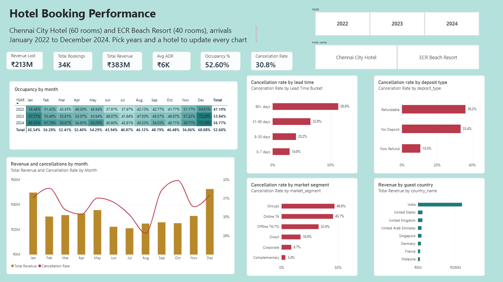

# Hotel Booking Data Analysis and Business Intelligence Dashboard

An end-to-end Power BI project that turns raw hotel booking records into an interactive dashboard on **occupancy, cancellations and revenue** for two hotels: a city hotel in Chennai and a beach resort on the ECR coast.



**Live web demo:** https://your-username.github.io/hotel-booking-bi-dashboard/web-demo/Hotel_Booking_Dashboard.html

## Table of contents
- [Overview](#overview)
- [Business questions](#business-questions)
- [Dataset](#dataset)
- [Tools and skills](#tools-and-skills)
- [Project workflow](#project-workflow)
- [Data cleaning](#data-cleaning)
- [Data model](#data-model)
- [DAX measures](#dax-measures)
- [Dashboard](#dashboard)
- [Key insights](#key-insights)
- [Repository structure](#repository-structure)
- [How to open the project](#how-to-open-the-project)
- [Limitations and future work](#limitations-and-future-work)
- [Author](#author)

## Overview
A hotel earns money only when its rooms are occupied at a good rate, yet about one booking in three is cancelled. This project builds a Power BI dashboard that shows management how many rooms are sold, how many bookings are lost and why, which guests and channels bring the most revenue, and how performance changes through the year.

**Headline numbers (all data, 2022 to 2024)**

| Metric | Value |
|---|---|
| Bookings analysed | 34,407 |
| Confirmed revenue | ₹38.29 crore |
| Revenue lost to cancellations | ₹21.28 crore |
| Cancellation rate | 30.8% |
| Average daily rate (ADR) | ₹5,980 |
| Occupancy | 52.6% |

## Business questions
1. How many bookings and how much revenue does each hotel generate each year?
2. What is the occupancy percentage by month and year?
3. What share of bookings are cancelled, and how does it differ between the two hotels?
4. Does a longer lead time lead to more cancellations?
5. Which market segments and channels bring the most revenue and the most cancellations?
6. How does deposit type affect cancellations?
7. Which months are busiest and which are slowest?
8. Which countries bring the most revenue?
9. How much revenue is lost to cancellations?
10. How do ADR and length of stay change by room type and over time?
11. Do repeat guests cancel less?

The full requirement analysis is in [`docs/Requirement_Analysis_Hotel_Booking_BI.pdf`](docs/Requirement_Analysis_Hotel_Booking_BI.pdf).

## Dataset
The dataset is a **simulated, realistic dataset created for this project** (it is not data from a real company). It is built around real hotel behaviour, with seasonality, cancellations that rise with lead time, and differences by segment, channel and deposit type. It also includes deliberate data quality problems so that cleaning is a real part of the project.

| File | Rows | Description |
|---|---|---|
| `hotel_bookings.csv` | 34,662 | Fact table, one row per booking (includes planted errors) |
| `dim_hotel.csv` | 2 | Hotel name, type, location, total rooms, star rating |
| `dim_room_type.csv` | 4 | Room type code and description |
| `dim_country.csv` | 10 | Country code, name and region |

- **Hotels:** Chennai City Hotel (60 rooms) and ECR Beach Resort (40 rooms)
- **Period:** arrivals from 1 January 2022 to 31 December 2024
- **Currency:** Indian rupees (INR)
- **Columns:** 31 in the fact table, such as `booking_date`, `arrival_date`, `lead_time`, `market_segment`, `deposit_type`, `adr_inr`, `is_canceled` and `reservation_status`

A full data dictionary is in [`docs/Dataset_Guide_Hotel_Booking_BI.pdf`](docs/Dataset_Guide_Hotel_Booking_BI.pdf).

## Tools and skills
- **Power BI Desktop:** Power Query (ETL), data modelling, DAX, report design
- **DAX:** measures and a calendar table
- **Python (pandas):** generating and validating the dataset
- **Skills shown:** data cleaning, star-schema modelling, KPI design, data visualisation, business storytelling

## Project workflow
1. **Requirement analysis:** problem statement, stakeholders, business questions and KPIs
2. **Dataset collection:** simulated dataset built around the requirements
3. **Data cleaning:** Power Query transformations (see below)
4. **Data modelling:** star schema with a date table
5. **DAX:** measures for revenue, cancellations, ADR, occupancy and RevPAR
6. **Dashboard:** interactive report with slicers and linked visuals
7. **Business insights:** findings and recommendations

## Data cleaning
All cleaning was done in Power Query. The full script is in [`scripts/PowerQuery_Cleaning_Script.txt`](scripts/PowerQuery_Cleaning_Script.txt).

| Step | Change | Rows affected |
|---|---|---|
| 1 | Promoted headers and set data types | none |
| 2 | Trimmed spaces in text columns | none |
| 3 | Removed duplicate bookings (on `booking_id`) | -150 |
| 4 | Replaced blank `children` with 0 | 300 |
| 5 | Replaced blank `country` with "Unknown" | about 500 |
| 6 | Removed bookings with zero guests | -60 |
| 7 | Removed negative prices | -25 |
| 8 | Removed extreme price outliers (City above ₹15,000, Resort above ₹30,000) | -20 |

**Result:** 34,662 rows reduced to **34,407** clean rows. Zero-price rows were kept because they are valid complimentary stays.

**New columns added:** `Total Guests`, `Total Nights`, `Booking Status`, `Lead Time Bucket`, `Booking Revenue`, `Lost Revenue`.

## Data model
A star schema with one fact table and four dimension tables.

```
              dimhotel
                 |
dimcountry --- factbookings --- DimDate
                 |
            dimroomtype
```

| From (many) | To (one) |
|---|---|
| `factbookings[hotel_id]` | `dimhotel[hotel_id]` |
| `factbookings[country]` | `dimcountry[country_code]` |
| `factbookings[room_type_reserved]` | `dimroomtype[room_type]` |
| `factbookings[arrival_date]` | `DimDate[Date]` |

`DimDate` is a calendar table created with DAX and marked as the date table. Month names are sorted by month number.

## DAX measures
```DAX
Total Bookings = COUNTROWS(factbookings)

Cancelled Bookings = CALCULATE([Total Bookings], factbookings[is_canceled] = 1)

Cancellation Rate = DIVIDE([Cancelled Bookings], [Total Bookings])

Total Revenue = SUM(factbookings[Booking Revenue])

Revenue Lost = SUM(factbookings[Lost Revenue])

Avg ADR = CALCULATE(AVERAGE(factbookings[adr_inr]), factbookings[is_canceled] = 0)

Room Nights Sold = CALCULATE(SUM(factbookings[Total Nights]), factbookings[is_canceled] = 0)

Rooms Available =
SUMX(
    VALUES(dimhotel[hotel_id]),
    CALCULATE(MAX(dimhotel[total_rooms])) * COUNTROWS(DimDate)
)

Occupancy % = DIVIDE([Room Nights Sold], [Rooms Available])

RevPAR = DIVIDE([Total Revenue], [Rooms Available])

Repeat Guest % =
DIVIDE(
    CALCULATE([Total Bookings], factbookings[is_repeated_guest] = 1),
    [Total Bookings]
)
```

**Definitions**
- **Revenue** is ADR multiplied by nights, counted only for confirmed bookings and in the month of arrival.
- **Occupancy** is confirmed room-nights sold divided by rooms available (total rooms multiplied by days).
- **RevPAR** is revenue per available room.

## Dashboard
The report is a **single, interactive page** titled *Hotel Booking Performance*. Clicking a year or a hotel in the slicers updates every card and chart on the page.

| Section | What it shows |
|---|---|
| Slicers | Year (2022, 2023, 2024) and hotel name (Chennai City Hotel, ECR Beach Resort) |
| KPI cards | Revenue lost, total bookings, total revenue, average ADR, occupancy %, cancellation rate |
| Occupancy by month | Heatmap of occupancy by month and year, darker meaning fuller |
| Revenue and cancellations by month | Revenue columns with the cancellation rate as a line, to see the seasonal pattern |
| Cancellation rate by lead time | How the days between booking and arrival change cancellations |
| Cancellation rate by deposit type | Refundable, no deposit and non-refundable bookings compared |
| Revenue by guest country | Top countries by confirmed revenue |
| Deep dive and insights | Written findings based on all data, 2022 to 2024 |

A web version of the same dashboard is in `web-demo/Hotel_Booking_Dashboard.html`. It is a separate interactive demo built from the same data, and also includes a market-segment chart.

## Key insights
- **Seasonality:** December is the strongest month (₹5.25 crore of revenue across the three years) and July the weakest (₹2.11 crore), so pricing and staffing should follow that swing.
- **Lead time:** bookings made 90 or more days ahead are cancelled 56.6% of the time, against 14.6% for bookings made within a week. Early bookers need a deposit or a reminder.
- **Segments (from the market-segment breakdown):** group bookings cancel most (46.9%), followed by online travel agents (45.7%). Corporate bookings cancel least among paying guests (8.7%).
- **Deposits:** refundable bookings cancel 36.2% of the time and non-refundable only 10.5%, so payment terms clearly change guest behaviour.
- **Markets:** India brings 61.2% of confirmed revenue, and cancellations have cost ₹21.28 crore in total.

**Recommendations**
1. Require deposits or non-refundable rates for bookings made far in advance.
2. Review overbooking limits for group and online travel agent bookings.
3. Use dynamic pricing around the December peak and discounts in the July trough.
4. Grow direct and corporate bookings, which cancel the least.

## Repository structure
```
hotel-booking-bi-dashboard/
├── README.md
├── data/
│   ├── raw/
│   │   ├── hotel_bookings.csv
│   │   ├── dim_hotel.csv
│   │   ├── dim_room_type.csv
│   │   └── dim_country.csv
│   └── cleaned/
│       └── hotel_bookings_cleaned.csv
├── powerbi/
│   └── HotelBooking.pbix
├── scripts/
│   └── PowerQuery_Cleaning_Script.txt
├── theme/
│   └── HotelTeal_PowerBI_Theme.json
├── docs/
│   ├── Requirement_Analysis_Hotel_Booking_BI.pdf
│   ├── Dataset_Guide_Hotel_Booking_BI.pdf
│   ├── PowerBI_Dashboard_Build_Kit.md
│   ├── Hotel_Booking_BI_Project.pptx
│   └── Hotel_Booking_BI_Project.pdf
├── web-demo/
│   └── Hotel_Booking_Dashboard.html
└── screenshots/
    └── dashboard.png
```

## How to open the project
1. Install **Power BI Desktop** (free, Windows).
2. Download or clone this repository.
3. Open `powerbi/HotelBooking.pbix`.
4. If Power BI says it cannot find the data, go to **Home > Transform data > Data source settings > Change Source** and point it to `data/raw/hotel_bookings.csv`.
5. Optional: import `theme/HotelTeal_PowerBI_Theme.json` from **Design > Import theme** for the colour scheme.

To rebuild from scratch, load the four CSV files in `data/raw`, paste the script from `scripts/PowerQuery_Cleaning_Script.txt` into the Advanced Editor (update the file path first), then follow `docs/PowerBI_Dashboard_Build_Kit.md`.

## Limitations and future work
- The data is simulated, so the insights illustrate typical hotel behaviour and are not results from a real business.
- Occupancy uses a fixed room count per hotel and ignores maintenance or closures.
- Possible next steps: a market-segment chart and a mobile layout on the dashboard, a cancellation prediction model, a forecast of monthly demand, and a page for guest segments and repeat-guest behaviour.

## Author
**[Your name]**
[LinkedIn profile](https://www.linkedin.com/) | [Email](mailto:your.email@example.com)

If you found this project useful, please give it a star.
